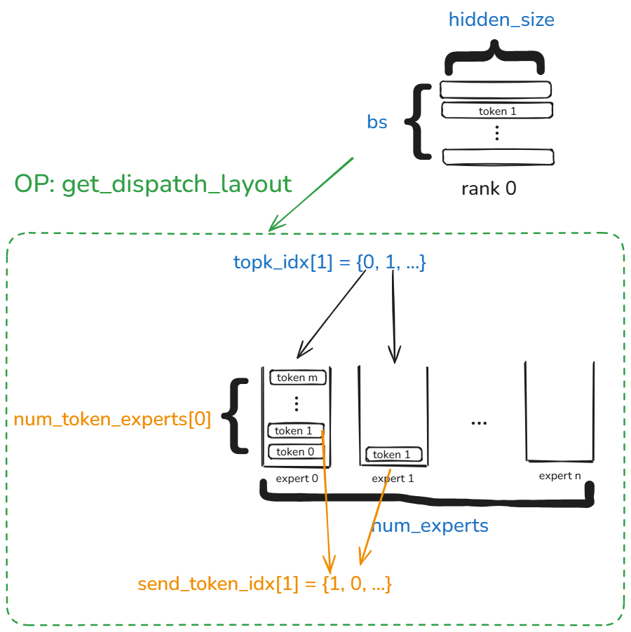
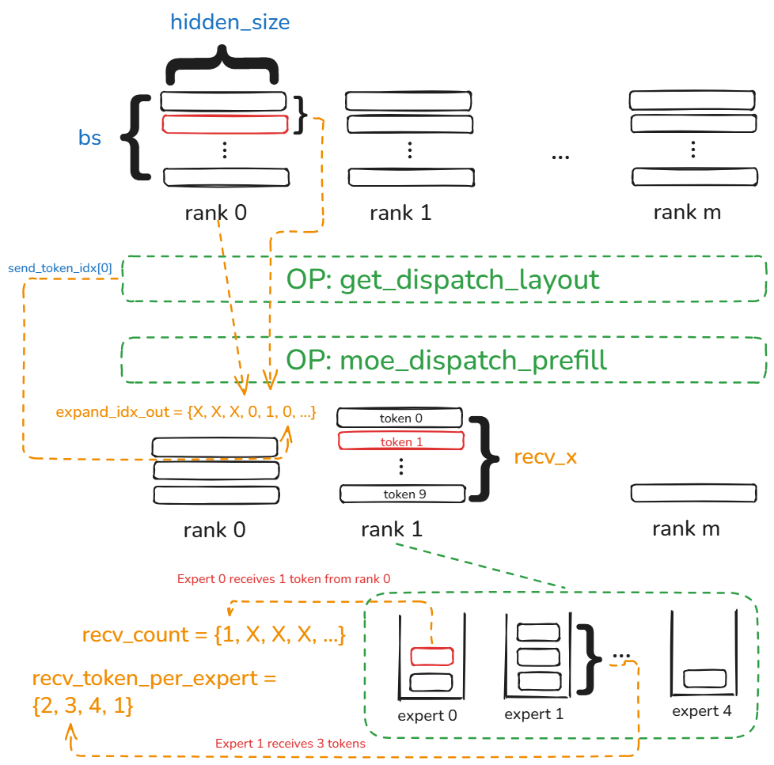

# CAM API指南
## CAM简介
CAM是Huawei昇腾NPU超节点通信加速器(Communication Accelerator for Maxtrix)的简称，提供EP（Expert Parallelism）通信加速库、PD（Prefill & Decode）分离场景高性能KVCache传输和KVC池化、AFD（Attention-FFN Disaggregation）通信加速库、RL(Reinforcement Learning)权重传输等特性。

## CAM架构
（To be done）

## CAM API
### 1. 高性能EP通信库
CAM在umdk_cam_op_lib库中提供高性能Python通信和通算融合接口供用户使用，用户可以方便的在主流昇腾推理框架（如vllm-ascend, sglang-kernel-npu等）导入该通信库并调用接口使用。
#### 1.1 Dispatch & Combine类接口
 #### 1.1.1 get_dispatch_layout ▶
##### 1.1.1.1 接口原型 
```python
get_dispatch_layout(
    Tensor topk_idx, 
    int num_experts, 
    int num_ranks)
-> output: tuple(Tensor, Tensor)
```
##### 1.1.1.2 接口描述 

A3代际Prefill阶段Dispatch使用的前置接口，用以在当前rank将Token拓展TopK份之后按照专家粒度重排，方便后续的分发操作。该接口需配合moe_dispatch_prefill和moe_combine_prefill使用。
##### 1.1.1.3 入参 
| **📌参数** | **🔧类型** | **✅是否必选** | **📋取值说明** | **📝描述** |
|----------|----------|--------------|--------------|----------|
|topk_idx|Tensor|必选|形状:(batch_size, topk)， int64类型，取值范围：[0, num_experts)|目标专家的ID信息|
|num_experts|int|必选|取值范围：(0, 512]|MOE专家数|
|num_ranks|int|必选|取值范围：[1, 384]|EP通信域rank数|
##### 1.1.1.4 返回值 
函数返回值是一个2个Tensor构成的Tuple，分别存放：num_tokens_per_expert和send_token_idx.
| **📌参数** | **🔧类型** | **📋取值说明** | **📝描述** |
|----------|----------|--------------|----------|
|num_tokens_per_expert|Tensor|形状：（num_experts）|当前rank上发送给每个专家的token个数|
|send_token_idx|Tensor|形状：(batch_size, top_k)|当前rank上，发送给每个专家的token在以专家重排分桶后，其在桶里的第几个位置|
##### 1.1.1.5 约束和注意事项 ⚠️
1. 入参形状需严格满足上述入参描述中的形状定义。
2. 当前接口只支持A3环境调用。
4. 当前接口不支持并发调用。
5. 当前接口不支持入图使用。
6. 除满足上述形状约束外，其他参数取值要求：
 - top_k取值范围：(0， 16]
 - batch_size取值范围：(0, 8000]
 - 需要满足: num_experts % num_ranks == 0
 - 需要满足：num_experts >= num_ranks

 #### 1.1.2 moe_dispatch_prefill ▶
##### 1.1.2.1 接口原型 
```python
moe_dispatch_prefill(
    Tensor x, 
    Tensor topk_idx, 
    Tensor topk_weights, 
    Tensor num_tokens_per_expert, 
    Tensor send_token_idx_small, 
    str group_ep, 
    int rank, 
    int num_ranks, 
    bool use_quant) 
-> output: tuple(Tensor, Tensor, Tensor, Tensor, Tensor)
```
##### 1.1.2.2 接口描述 

A3代际Prefill阶段Dispatch接口，将Token按照topk_idx的规则发送给对应专家。
##### 1.1.2.3 入参 
| **📌参数** | **🔧类型** | **✅是否必选** | **📋取值说明** | **📝描述** |
|----------|----------|--------------|--------------|----------|
|x|Tensor|必选|形状:(batch_size, hidden_size), 支持bf16, float16类型|本卡发送的token|
|topk_idx|Tensor|必选|形状:(batch_size, topk)， 数据类型为int64，取值范围：[0, num_experts)|每个token的目标专家ID信息|
|topk_weights|Tensor|必选|形状:(batch_size, topk)， 数据类型为float32|每个token的topk个目标专家的权重信息|
|num_tokens_per_expert|Tensor|必选|形状：（num_experts），数据类型为int|当前rank上发送给每个专家的token个数，必须为get_dispatch_layout的出参num_tokens_per_expert，不可篡改|
|send_token_idx_small|Tensor|必选|形状：(batch_size, top_k), 数据类型为int|当前rank上，发送给每个专家的token在以专家重排分桶后，其在桶里的第几个位置，必须为get_dispatch_layout的出参send_token_idx，不可篡改|
|group_ep|str|必选|--|HCCL通信域名称|
|rank|int|必选|[0, num_ranks)|本卡在通信域中的rankID|
|num_ranks|int|必选|[2, 384]|EP通信域rank数|
|use_quant|bool|必选|True: 开启量化； False: 关闭量化|Dispatch量化指示符|
##### 1.1.2.4 返回值 
函数返回值是一个5个Tensor构成的Tuple，分别存放：recv_x, dynamic_scales_out, expand_idx_out, recv_count, recv_tokens_per_expert.
| **📌参数** | **🔧类型** | **📋取值说明** | **📝描述** |
|----------|----------|--------------|----------|
|recv_x|Tensor|形状：(recv_token_num, hidden_size), 其中recv_token_num为本卡收到的token个数。当use_quant为true时，数据类型为int8, false时数据类型与入参x一致|当前rank上收到的token信息|
|dynamic_scales_out|Tensor|形状：(recv_token_num), 数据类型为float.当use_quant为false时该值没有意义。|当前rank上收到token的动态量化scale信息|
|expand_idx_out|Tensor|形状：(recv_token_num * 3), 数据类型为int|本卡收到的token信息三元组，每组三个数的含义依次为：token的源rank, token在源rank的序号（BS视角），token在源rank时topk专家扩展重排后的序号（专家视角）|
|recv_count|Tensor|形状：(num_experts), 数据类型为int|当前rank上每个专家从每个rank收到的收到token数，为前缀和|
|recv_tokens_per_expert|Tensor|形状：(local_expert_num), 数据类型为int64|当前rank上每个专家收到的token信息|
##### 1.1.2.5 约束和注意事项 ⚠️
1. 入参形状需严格满足上述入参描述中的形状定义。
2. 当前接口只支持A3环境调用。
3. 当前接口不支持并发调用。
4. 当前接口不支持入图使用。
5. 除满足上述形状约束外，其他参数取值要求：
 - 需要满足：BS取值范围[1, 8K]
 - 需要满足: num_ranks取值范围[2, 384]
 - 需要满足: num_experts取值范围(0, 512]
 - 需要满足: topk取值范围(0, 16]
 - 需要满足: (num_experts % num_ranks) == 0
 - 需要满足: 配置全局宏HCCL_BUFFSIZE=4096
 - 需要满足：num_experts >= num_ranks

 #### 1.1.3 moe_combine_prefill ▶
##### 1.1.3.1 接口原型 
```python
moe_combine_prefill(
    Tensor x, 
    Tensor topk_idx, 
    Tensor topk_weights, 
    Tensor src_idx, 
    Tensor send_head,
    str group_ep, 
    int rank, 
    int num_ranks) 
-> output: Tensor
```
##### 1.1.3.2 接口描述 

A3代际Prefill阶段Combine接口，将按照topk_idx的规则发送给对应专家的token，按照topk_weights指定的权重收回。
##### 1.1.3.3 入参 
| **📌参数** | **🔧类型** | **✅是否必选** | **📋取值说明** | **📝描述** |
|----------|----------|--------------|--------------|----------|
|x|Tensor|必选|形状:(recv_token_num, hidden_size), 支持bf16, float16类型|本卡dispatch阶段收集到的token|
|topk_idx|Tensor|必选|形状:(batch_size, topk)， 数据类型为int64，取值范围：[0, num_experts)|每个token的目标专家ID信息|
|topk_weights|Tensor|必选|形状:(batch_size, topk)， 数据类型为float32|每个token的topk个目标专家的权重信息|
|src_idx|Tensor|必选|形状：(recv_token_num * 3), 数据类型为int|本卡收到的token信息三元组，每组三个数的含义依次为：token的源rank, token在源rank的序号（BS视角），token在源rank时topk专家扩展重排后的序号（专家视角）。必须为moe_dispatch_prefill的出参expand_idx_out，不可篡改|
|send_head|Tensor|必选|形状：(num_experts), 数据类型为int|当前rank上每个专家从其他rank收到的token数前缀和。必须为moe_dispatch_prefill的出参recv_count，不可篡改|
|group_ep|str|必选|--|HCCL通信域名称|
|rank|int|必选|[0, num_ranks)|本卡在通信域中的rankID|
|num_ranks|int|必选|[2, 384]|EP通信域rank数|
##### 1.1.3.4 返回值 
函数返回值是一个Tensor，存放combine_x信息。
| **📌参数** | **🔧类型** | **📋取值说明** | **📝描述** |
|----------|----------|--------------|----------|
|combine_x|Tensor|形状：(batch_size, hidden_size)。数据类型与x一致|当前rank上收到的token信息|
##### 1.1.3.5 约束和注意事项 ⚠️
1. 入参形状需严格满足上述入参描述中的形状定义。
2. 当前接口只支持A3环境调用。
3. 当前接口不支持并发调用。
4. 当前接口不支持入图使用。
5. 除满足上述形状约束外，其他参数取值要求：
 - 需要满足：BS取值范围[1, 8K]
 - 需要满足: num_ranks取值范围[2, 384]
 - 需要满足: num_experts取值范围(0, 512]
 - 需要满足: topk取值范围(0, 16]
 - 需要满足: (num_experts % num_ranks) == 0
 - 需要满足: 配置全局宏HCCL_BUFFSIZE=4096
 - 需要满足：num_experts >= num_ranks
6. combine_x精度校验标准
 - 非量化场景下平均相对误差为千分之五
 - 量化场景下平均相对误差为百分之一

 #### 1.1.4 fused_deep_moe ▶
##### 1.1.4.1 接口原型 
```python
fused_deep_moe(
    Tensor x, 
    Tensor expert_ids, 
    Tensor[] gmm1_weight, 
    Tensor[] gmm1_weight_scale, 
    Tensor[] gmm2_weight, 
    Tensor[] gmm2_weight_scale, 
    Tensor expert_scales, 
    Tensor? share_gmm1_weight, 
    Tensor? share_gmm1_weight_scale, 
    Tensor? share_gmm2_weight, 
    Tensor? share_gmm2_weight_scale, 
    Tensor? expert_smooth_scales,
    Tensor? share_smooth_scales,
    Tensor? x_active_mask, 
    str group_ep, 
    int ep_rank_size, 
    int ep_rank_id, 
    int moe_expert_num, 
    int quant_mode, 
    int global_bs) 
-> output: Tensor[]
```
##### 1.1.4.2 接口描述 
用于MoE Decode阶段的通算大融合算子，通过融合[Dispatch + FFN(GMM1 + Swiglu + GMM2) + Combine]实现高效的模型推理和专家选择，（可选）同时支持内置共享专家计算，适用于分布式推理场景。
##### 1.1.4.3 入参 
| **📌参数** | **🔧类型** | **✅是否必选** | **📋取值说明** | **📝描述** |
|----------|----------|--------------|--------------|----------|
|x|Tensor|必选|形状:(batch_size, token_length), 支持bf16, float16类型|本卡dispatch阶段待处理的token|
|expert_ids|Tensor|必选|形状:(batch_size, topk)， 数据类型为int32, 取值范围[-1, num_experts)，-1用于占位使用，一个token不允许重复发给同一个专家|每个token的目标专家ID信息|
|gmm1_weight|Tensor[]|必选|耦合模式下，只有一个Tensor, 形状:(localExpertNum, token_length, gmm1_hidden_size); 分离模式下，包含localExpertNum个Tensor, 每个Tensor形状：（token_length, gmm1_hidden_size），数据类型为int8|GMM1的权重矩阵列表，支持耦合模式和分离模式|
|gmm1_weight_scale|Tensor[]|必选|耦合模式下，只有一个Tensor, 形状:(localExpertNum, gmm1_hidden_size); 分离模式下，包含localExpertNum个Tensor, 每个Tensor形状：（gmm1_hidden_size），数据类型为float32或与x数据类型一致|GMM1的权重矩阵量化时使用的缩放系数列表，支持耦合模式和分离模式|
|gmm2_weight|Tensor[]|必选|耦合模式下，只有一个Tensor, 形状:(localExpertNum, gmm1_hidden_size/2, token_length); 分离模式下，包含localExpertNum个Tensor, 每个Tensor形状：（gmm1_hidden_size/2, token_length），数据类型为int8|GMM2的权重矩阵列表，支持耦合模式和分离模式|
|gmm2_weight_scale|Tensor[]|必选|耦合模式下，只有一个Tensor, 形状:(localExpertNum, token_length); 分离模式下，包含localExpertNum个Tensor, 每个Tensor形状：（token_length），数据类型为float32或与x数据类型一致|GMM2的权重矩阵量化时使用的缩放系数列表，支持耦合模式和分离模式|
|expert_scales|Tensor|必选|形状：(batch_size, topk), 数据类型为float32|每个专家的权重，combine阶段使用|
|share_gmm1_weight|Tensor|可选|形状：（token_length, share_mm1_hidden_size），数据类型为int8|共享专家MM1的权重矩阵|
|share_gmm1_weight_scale|Tensor|可选|形状：（share_mm1_hidden_size），数据类型为与gmm1_weight_scale一致|共享专家MM1的权重矩阵量化时使用的缩放系数|
|share_gmm2_weight|Tensor|可选|形状：（share_mm1_hidden_size/2, token_length），数据类型为int8|共享专家MM2的权重矩阵|
|share_gmm2_weight_scale|Tensor|可选|形状：（token_length），数据类型为与gmm2_weight_scale一致|共享专家MM2的权重矩阵量化时使用的缩放系数|
|expert_smooth_scales|Tensor|可选|形状：(moe_expert_num，token_length)，数据类型为float32|各个路由专家的smooth quant平滑因子|
|share_smooth_scales|Tensor|可选|形状：(token_length)，数据类型为float32|共享专家的smooth quant平滑因子|
|x_active_mask|Tensor|可选|形状： (batch_size)，数据类型bool，取值范围[true, false]，true值一定要在false之前|dispatch分发token时的mask，true代表正常分发该token，false代表不分发|
|group_ep|str|必选|字符串长度范围：(0, 128), 且需要保证是有效的通信域名称|HCCL通信域名称|
|ep_rank_size|int|必选|需要满足：(ep_rank_size * MoeExpertNumPerRank) ≤ 512且ep_rank_size > 0|EP通信域大小|
|ep_rank_id|int|必选|[0, ep_rank_size)|本卡在通信域中的rankID|
|moe_expert_num|int|必选|需要满足：moe_expert_num % ep_rank_size == 0|MOE专家数量|
|quant_mode|int|必选|预留入参，当前只支持传0|量化模式|
|global_bs|int|必选|若所有卡的token数量一致，可以传入0或者batch_size * ep_rank_size; 若所有卡的token数量不一致，需要传入max_batch_size * ep_rank_size|所有卡的最大token总数|
##### 1.1.4.4 返回值 
函数返回值是一个Tensor列表，存放combine_x和expert_token_nums信息。
| **📌参数** | **🔧类型** | **📋取值说明** | **📝描述** |
|----------|----------|--------------|----------|
|combine_x|Tensor|形状：(batch_size, token_length)。数据类型与x一致|当前rank上token经各个专家处理后汇聚的结果|
|share_output|Tensor|形状：(batch_size, token_length)。数据类型与x一致|内置共享专家处理后的结果，即使不进行共享专家计算，也会返回该值占位|
|expert_token_nums|Tensor|形状：(local_expert_num)。数据类型为int64|本卡各个专家收到的token数量|
##### 1.1.4.5 约束和注意事项 ⚠️
1. 入参形状需严格满足上述入参描述中的形状定义。
2. 当前接口只支持A3环境调用。
3. 当前接口不支持并发调用。极端情况下在单次forward中连续调用相同算子会产生未定义行为，这种场景需要在算子执行间添加torch.npu.synchronize()避免潜在的异步时序问题。
4. 当前接口图模式只支持AclGraph模式。
5. 不支持外置共享专家（即有的卡只放置共享专家）。
6. Batch_size小于16时非目标场景，其性能相对于小算子拼接可能劣化，建议性能对比后决策使用。
7. 除满足上述形状约束外，其他参数取值要求：
 - 需要满足：BS取值范围[0, 256]
 - 需要满足: token_length取值范围[1024， 7168]且(token_length % 256) == 0
 - 需要满足: gmm1_hidden_size取值范围[1024， 6144]且(gmm1_hidden_size % 1024) == 0
 - 需要满足: share_gmm1_hidden_size取值范围[1024， 6144]且(share_gmm1_hidden_size % 1024) == 0
 - 需要满足: topk取值范围[0, 12]且应保证小于等于专家数
 - 需要满足：global_bs ≥ 0 且保证（global_bs % ep_rank_size） == 0
 - 需要满足: gmm1_weight, gmm1_weight_scale, gmm2_weight, gmm2_weight_scale四个入参的模式必须统一，不能一部分耦合模式一部分分离模式
 - 需要满足: HCCL_BUFFSIZE环境变量配置应不小于[(ep_rank_size * max_batch_size * moe_expert_num_per_rank * total_length * sizeof(x) * 2) / 1024 / 1024]向上取整
 - 需要满足: 若要进行内置共享专家计算，则共享专家所需的share_gmm1_weight、share_gmm1_weight_scale、share_gmm2_weight、share_gmm2_weight_scale需同时存在
- 需要满足: 若要进行smooth quant，需传入expert_smooth_scales，若同时进行内置共享专家计算则share_smooth_scales也必须存在

#### 1.2 Zero-Buffer Dispatch & Combine 类接口
基于 SHMEM 实现的 Zero-Buffer DeepEP 风格 Prefill 接口，通过 PyTorch eager 模式调用。Python 入口为 `umdk_cam_op_lib.ZbBuffer`，调用链路为：创建 `ZbBuffer` → `buf.get_dispatch_layout` → `buf.dispatch`（内部 notify + dispatch）→ 专家计算 → `buf.combine`。

`ZbBuffer` 管理 SHMEM 初始化、通信元数据和通信缓冲区；当前不提供独立的 `umdk_cam_op_lib.get_dispatch_layout_zb`、`umdk_cam_op_lib.moe_dispatch_normal_zb` 或 `umdk_cam_op_lib.moe_combine_normal_zb` Python 函数。以下说明以当前 Python 接口为准。

 #### 1.2.1 ZbBuffer ▶
##### 1.2.1.1 接口原型
```python
umdk_cam_op_lib.ZbBuffer(
    int rank,
    int num_ranks,
    int local_mem_size,
    str ip_port,
    int hidden,
    int num_experts,
    bool use_quant,
    int global_bs
) -> buf: ZbBuffer
```
##### 1.2.1.2 接口描述
创建 Zero-Buffer 通信对象，在当前 NPU 设备上初始化 SHMEM，分配通信元数据及 layout / notify 缓冲区。dispatch / combine 的 SHMEM 缓冲区在第一次 `dispatch` 时分配并复用。

EP rank、专家数、隐藏维度、量化开关和全局 batch 上界由构造参数指定。方法内部使用这些参数及对象管理的 `comm_meta_ptr`；TP 参数固定为 `tp_world_size=1`、`tp_rank_id=0`，调用方法时无需另行传入。
##### 1.2.1.3 入参
| **📌参数** | **🔧类型** | **✅是否必选** | **📋取值说明** | **📝描述** |
|----------|----------|--------------|--------------|----------|
|rank|int|必选|`[0, num_ranks)`|本卡在 EP 通信域中的 rank ID，不等同于本机 NPU 设备 ID|
|num_ranks|int|必选|`[2, 384]`|EP 通信域大小|
|local_mem_size|int|必选|正整数，单位为字节|每个 rank 的 SHMEM 内存池大小，须覆盖通信缓冲区、元数据及分配开销|
|ip_port|str|必选|如 `tcp://127.0.0.1:8666`；跨节点时使用所有 rank 可访问的地址|SHMEM 初始化地址，同一通信域各 rank 使用相同地址|
|hidden|int|必选|`[1024, 7168]`|token 隐藏维度，须与 `x.size(1)` 一致|
|num_experts|int|必选|`(0, 512]`，且能被 `num_ranks` 整除|路由专家总数，须不小于 `num_ranks`|
|use_quant|bool|必选|`False`：不量化；`True`：动态量化|须与 `dispatch` 的 `quant_mode` 一致|
|global_bs|int|必选|正整数，使用 `max_batch_size * num_ranks`|全局 batch 上界；`max_batch_size` 须覆盖所有 rank 本轮及后续复用时的本地 token 数|
##### 1.2.1.4 返回值
返回 `ZbBuffer` 对象。`buf.is_initialized()` 查询初始化状态；`buf.get_comm_meta_ptr()` 可获取内部通信元数据地址，正常调用 layout / dispatch / combine 无需使用该地址。
##### 1.2.1.5 约束和注意事项 ⚠️
1. 仅支持 A3 环境。构建 `umdk_cam_op_lib` 时须设置 `SHMEM_HOME_PATH` 并启用 SHMEM 支持；调用构造函数前须先通过 `torch.npu.set_device` 设置当前设备。
2. 同一通信域各 rank 应使用一致的 `num_ranks`、`local_mem_size`、`ip_port`、`hidden`、`num_experts`、`use_quant` 和 `global_bs`，按相同顺序执行通信调用。
3. `local_experts = num_experts // num_ranks`。第一次 dispatch 按 `capacity = global_bs * min(topk, local_experts)` 分配接收/合并缓冲区；同一个 token 的 topk 专家 ID 不应重复。
4. bf16 / fp16 合并缓冲区大小为 `capacity * hidden * 2` 字节；量化时额外分配 `capacity * 4` 字节的 scales，int8 接收区与合并区共享底层内存。内存池还需包含 2 MiB 通信元数据、layout / notify 缓冲区及分配开销。可参考示例中的 `estimate_zb_shmem_bytes` 估算大小。
5. 第一次 dispatch 确定输入 dtype 和缓冲区容量；后续 dispatch 的 dtype 必须一致，且所需容量不能超过首次分配的容量。
6. 对象按顺序复用内部缓冲区，不应并发调用或交错执行多轮 layout / dispatch / combine。返回的 SHMEM Tensor 是对象持有缓冲区的视图；后续调用可能覆盖数据，需长期保留时应先复制到独立 Tensor。
7. 销毁对象会释放 SHMEM 缓冲区并结束 SHMEM 会话。须先完成使用这些缓冲区的 NPU 操作（例如调用 `torch.npu.synchronize()`）；对象销毁后不能继续使用其 SHMEM Tensor 视图或元数据地址。

 #### 1.2.2 ZbBuffer.get_dispatch_layout ▶
##### 1.2.2.1 接口原型
```python
buf.get_dispatch_layout(
    Tensor topk_idx
) -> output: Tuple[Tensor, Tensor]
```
##### 1.2.2.2 接口描述
根据每个 token 的 topk 专家索引，统计当前 rank 发给各专家的 token 数，并计算每个 `(token, topk)` 在目标专家视角下的本地发送序号。专家数和 rank 数取自 `ZbBuffer` 构造参数，底层调用 `aclnnDispatchLayoutZb`。
##### 1.2.2.3 入参
| **📌参数** | **🔧类型** | **✅是否必选** | **📋取值说明** | **📝描述** |
|----------|----------|--------------|--------------|----------|
|topk_idx|Tensor|必选|形状：`(batch_size, topk)`，建议使用 `torch.int32`|目标专家 ID；layout 内部会将非 int32 输入转换为 int32，但不会修改原 Tensor，后续 dispatch / combine 仍须传入 int32|
##### 1.2.2.4 返回值
返回由 2 个 Tensor 构成的 Tuple：`num_tokens_per_expert`、`send_token_idx`。
| **📌参数** | **🔧类型** | **📋取值说明** | **📝描述** |
|----------|----------|--------------|----------|
|num_tokens_per_expert|Tensor|形状：`(num_experts,)`，数据类型 `torch.int32`；位于 SHMEM|当前 rank 发给各专家的 token 数，复用对象内部缓冲区|
|send_token_idx|Tensor|形状：`(batch_size, topk)`，数据类型 `torch.int32`|每个 token 发给对应专家时，在该专家从当前 rank 接收的 token 中的本地序号|
##### 1.2.2.5 约束和注意事项 ⚠️
1. `batch_size` 取值范围：`[1, 8000]`，且不超过构造时的 `global_bs // num_ranks`。
2. `topk` 取值范围：`(0, min(16, num_experts)]`；专家 ID 取值范围：`[0, num_experts)`，同一 token 的专家 ID 不应重复。
3. 输入须位于对象所属 NPU 设备上，转换后的 int32 Tensor 须为二维连续 Tensor。
4. 输出须直接交给同一对象本轮 `dispatch` 使用，不可改写；完成本轮 combine 前不应重新调用 layout。

 #### 1.2.3 ZbBuffer.dispatch ▶
##### 1.2.3.1 接口原型
```python
buf.dispatch(
    Tensor x,
    Tensor topk_idx,
    Tensor send_token_idx,
    Tensor num_tokens_per_expert,
    int quant_mode
) -> output: Tuple[Tensor, Tensor, Tensor]
```
##### 1.2.3.2 接口描述
将 `x` 按 `topk_idx` 规则发送给对应专家。方法内部依次调用 `aclnnNotifyDispatchZb` 和 `aclnnMoeDispatchNormalZb`（对应底层 `moe_dispatch_normal_zb` 算子），保存 combine 所需的发送序号，并返回接收数据、量化 scales 和本轮通信 handle。
##### 1.2.3.3 入参
| **📌参数** | **🔧类型** | **✅是否必选** | **📋取值说明** | **📝描述** |
|----------|----------|--------------|--------------|----------|
|x|Tensor|必选|形状：`(batch_size, hidden)`，数据类型 `torch.bfloat16` 或 `torch.float16`|本卡发送的 token，设备和隐藏维度须与对象一致|
|topk_idx|Tensor|必选|形状：`(batch_size, topk)`，数据类型 `torch.int32`|本轮 layout 使用的专家 ID 信息|
|send_token_idx|Tensor|必选|形状：`(batch_size, topk)`，数据类型 `torch.int32`|同一对象本轮 layout 的 `send_token_idx` 输出|
|num_tokens_per_expert|Tensor|必选|形状：`(num_experts,)`，数据类型 `torch.int32`；位于 SHMEM|同一对象本轮 layout 的 `num_tokens_per_expert` 输出|
|quant_mode|int|必选|`0`：不量化，要求 `use_quant=False`；`2`：动态量化，要求 `use_quant=True`|dispatch 量化模式|
##### 1.2.3.4 返回值
返回由 3 个 Tensor 构成的 Tuple：`recv_x`、`scales`、`handle`。

设内部 notify 得到的实际接收 token 数为 `total_recv_tokens`，当前实现返回行数 `recv_rows = max(total_recv_tokens, 1)`。
| **📌参数** | **🔧类型** | **📋取值说明** | **📝描述** |
|----------|----------|--------------|----------|
|recv_x|Tensor|形状：`(recv_rows, hidden)`；量化时为 `torch.int8`，否则与 `x` dtype 一致；位于 SHMEM|已在方法内部按接收数量截断的接收区视图|
|scales|Tensor|数据类型 `torch.float32`；量化时形状为 `(recv_rows,)`，位于 SHMEM；不量化时形状为 `(1,)`|量化时为各接收 token 的动态量化 scale；不量化时仅为占位，无有效数值语义|
|handle|Tensor|形状：`(num_experts, num_ranks)`，数据类型 `torch.int32`|内部 notify 生成的 `put_offset`，须原样传给本轮 combine|
##### 1.2.3.5 约束和注意事项 ⚠️
1. `batchSize` 取值范围：`[1, 8000]`。
2. `ep_world_size` 取值范围：`[2, 384]`。
3. `ep_rank_id` 取值范围：`[0, ep_world_size)`。
4. `moe_expert_num` 取值范围：`(0, 512]`。
5. `topk` 取值范围：`(0, 16]`。
6. `topk_idx` 中数值取值范围：`[0, moe_expert_num)`。
7. `h` 取值范围：`[1024, 7168]`。
8. `moe_expert_num % ep_world_size == 0`，且 `moe_expert_num >= ep_world_size`。
9. `recv_x` 应与 `moe_dispatch_normal_zb` 有效接收区间一致（按 `total_recv_tokens` 截断后的专家输出）。
10. `ep_recv_counts` 必须直接使用 dispatch 内部 notify 的 `put_offset`（或等价 ep send/recv counts）。
11. `send_token_idx` 若传入，必须直接使用 `get_dispatch_layout_zb` 的出参。
12. 调用前需保证 `comm_meta_ptr` 有效，且与 dispatch 使用同一通信域初始化结果。
13. 不支持 A2 环境（仅 A3）。

 #### 1.2.4 zb_fused_deep_moe ▶
##### 1.2.4.1 接口原型
```python
ZbBuffer.zb_fused_deep_moe(
    Tensor x,
    Tensor expert_ids,
    Tensor[] gmm1_weight,
    Tensor[] gmm1_weight_scale,
    Tensor[] gmm2_weight,
    Tensor[] gmm2_weight_scale,
    Tensor expert_scales,
    Tensor? share_gmm1_weight,
    Tensor? share_gmm1_weight_scale,
    Tensor? share_gmm2_weight,
    Tensor? share_gmm2_weight_scale,
    Tensor? expert_smooth_scales,
    Tensor? share_smooth_scales,
    Tensor? x_active_mask,
    Tensor[] gmm1_bias,
    Tensor[] gmm2_bias,
    Tensor? share_gmm1_bias,
    Tensor? share_gmm2_bias,
    str group_ep,
    int ep_rank_size,
    int ep_rank_id,
    int moe_expert_num,
    int quant_mode,
    int global_bs
) -> output: Tuple[Tensor, Tensor, Tensor]
```
##### 1.2.4.2 接口描述
Zero-Buffer（SHMEM）路径下的通算大融合算子，融合 [Dispatch + FFN(GMM1 + SwiGLU + GMM2) + Combine]，通过 SHMEM 共享内存直写替代 HCCL 数据平面，支持 W8A8 / W4A8 两种量化模式（W4A8 以 `gmm1_bias` 输入是否存在自动识别）、内置共享专家与多轮 round buffer 复用。需先完成 `ZbBuffer` 初始化并提供 SHMEM 池（`local_mem_size`），底层调用 `aclnnFusedDeepMoeZb`；`ext_info`、`shmem_workspace`、`shmem_workspace_size` 三个 attr 由 `ZbBuffer` 内部自动注入，用户无需传入。
##### 1.2.4.3 入参
| **📌参数** | **🔧类型** | **✅是否必选** | **📋取值说明** | **📝描述** |
|----------|----------|--------------|--------------|----------|
|x|Tensor|必选|形状：`(batch_size, token_length)`，支持 bf16、float16，FORMAT_ND|本卡 dispatch 阶段待处理的 token|
|expert_ids|Tensor|必选|形状：`(batch_size, topk)`，数据类型 `torch.int32`，取值范围 `[-1, moe_expert_num)`，-1 用于占位，一个 token 不允许重复发给同一个专家|每个 token 的目标专家 ID 信息|
|gmm1_weight|Tensor[]|必选|耦合模式下仅有 1 个 Tensor，形状：`(local_expert_num, token_length, gmm1_hidden_size)`；分离模式下包含 `local_expert_num` 个 Tensor，每个形状：`(token_length, gmm1_hidden_size)`；W8A8 为 `torch.int8`，W4A8 为 `torch.int32`（INT4 打包，隐藏维按 `gmm1_hidden_size/8` 存储）|GMM1 权重矩阵列表，支持耦合/分离两种模式|
|gmm1_weight_scale|Tensor[]|必选|耦合模式下仅有 1 个 Tensor，形状：`(local_expert_num, gmm1_hidden_size)`；分离模式下包含 `local_expert_num` 个 Tensor，每个形状：`(gmm1_hidden_size)`；数据类型 float32/bf16/fp16|GMM1 权重量化缩放系数，模式须与 gmm1_weight 一致|
|gmm2_weight|Tensor[]|必选|耦合模式下仅有 1 个 Tensor，形状：`(local_expert_num, gmm1_hidden_size/2, token_length)`；分离模式下包含 `local_expert_num` 个 Tensor，每个形状：`(gmm1_hidden_size/2, token_length)`；W8A8 为 `torch.int8`，W4A8 为 `torch.int32`（隐藏维按 `gmm1_hidden_size/2` 存储，INT4 打包时输出维按 1/8 压缩）|GMM2 权重矩阵列表，支持耦合/分离两种模式|
|gmm2_weight_scale|Tensor[]|必选|耦合模式下仅有 1 个 Tensor，形状：`(local_expert_num, token_length)`；分离模式下包含 `local_expert_num` 个 Tensor，每个形状：`(token_length)`；数据类型 float32/bf16/fp16|GMM2 权重量化缩放系数，模式须与 gmm2_weight 一致|
|expert_scales|Tensor|必选|形状：`(batch_size, topk)`，数据类型 `torch.float32`|每个 token 的 topk 个专家权重，combine 阶段使用|
|share_gmm1_weight|Tensor?|可选|形状：`(token_length, share_mm1_hidden_size)`，W8A8 为 `torch.int8`，W4A8 为 `torch.int32`|共享专家 MM1 权重矩阵|
|share_gmm1_weight_scale|Tensor?|可选|形状：`(share_mm1_hidden_size)`，数据类型须与 gmm1_weight_scale 一致|共享专家 MM1 权重量化缩放系数|
|share_gmm2_weight|Tensor?|可选|形状：`(share_mm1_hidden_size/2, token_length)`，W8A8 为 `torch.int8`，W4A8 为 `torch.int32`|共享专家 MM2 权重矩阵|
|share_gmm2_weight_scale|Tensor?|可选|形状：`(token_length)`，数据类型须与 gmm2_weight_scale 一致|共享专家 MM2 权重量化缩放系数|
|expert_smooth_scales|Tensor?|可选|形状：`(moe_expert_num, token_length)`，数据类型 `torch.float32`|各个路由专家的 smooth quant 平滑因子|
|share_smooth_scales|Tensor?|可选|形状：`(token_length)`，数据类型 `torch.float32`|共享专家的 smooth quant 平滑因子|
|x_active_mask|Tensor?|可选|形状：`(batch_size)`，数据类型 bool，取值范围 `[true, false]`，true 值必须排在 false 之前|dispatch 分发 token 时的 mask，true 代表正常分发，false 代表不分发|
|gmm1_bias|Tensor[]|W4A8 必选|耦合模式下仅有 1 个 Tensor，形状：`(local_expert_num, gmm1_hidden_size)`；分离模式下包含 `local_expert_num` 个 Tensor，每个形状：`(gmm1_hidden_size)`；数据类型 `torch.float32`|W4A8 反量化补偿矩阵，`8.0 × Σ(INT4 权重) × weight_scale`，W8A8 传空 TensorList|
|gmm2_bias|Tensor[]|W4A8 必选|耦合模式下仅有 1 个 Tensor，形状：`(local_expert_num, token_length)`；分离模式下包含 `local_expert_num` 个 Tensor，每个形状：`(token_length)`；数据类型 `torch.float32`|W4A8 反量化补偿矩阵，`8.0 × Σ(INT4 权重) × weight_scale`，W8A8 传空 TensorList|
|share_gmm1_bias|Tensor?|可选|形状：`(share_mm1_hidden_size)`，数据类型 `torch.float32`|共享专家 MM1 的 W4A8 反量化补偿矩阵|
|share_gmm2_bias|Tensor?|可选|形状：`(token_length)`，数据类型 `torch.float32`|共享专家 MM2 的 W4A8 反量化补偿矩阵|
|group_ep|str|必选|Zero-Buffer 路径传空字符串 `""`|HCCL 通信域名称（预留；数据平面走 SHMEM 直写，无需真实通信域）|
|ep_rank_size|int|必选|> 0，且 `moe_expert_num_per_rank * ep_rank_size <= 512`|EP 通信域大小|
|ep_rank_id|int|必选|取值范围 `[0, ep_rank_size)`|本卡在通信域中的 rankID|
|moe_expert_num|int|必选|取值范围 `(0, 512]`，且 `moe_expert_num % ep_rank_size == 0`|MOE 路由专家数量|
|quant_mode|int|必选|预留入参，当前只支持传 0|量化模式；W4A8 由 gmm1_bias 输入存在性自动识别，不依赖该入参|
|global_bs|int|必选|若所有卡 token 数量一致，可传 0（等价于 `batch_size * ep_rank_size`）；否则须 > 0 且 `global_bs % ep_rank_size == 0`|所有卡的最大 token 总数|
##### 1.2.4.4 返回值
函数返回值是一个 3 个 Tensor 构成的 Tuple，分别存放：output、share_output、expert_token_nums。
| **📌参数** | **🔧类型** | **📋取值说明** | **📝描述** |
|----------|----------|--------------|----------|
|output|Tensor|形状：`(batch_size, token_length)`，数据类型与 x 一致|当前 rank 上 token 经各个专家处理后汇聚的结果|
|share_output|Tensor|形状：`(batch_size, token_length)`，数据类型与 x 一致|内置共享专家处理后的结果，即使不进行共享专家计算也会返回占位值|
|expert_token_nums|Tensor|形状：`(moe_expert_num / ep_rank_size)`，数据类型 `torch.int64`|本卡各个本地专家收到的 token 数量|
##### 1.2.4.5 约束和注意事项 ⚠️
1. 入参形状需严格满足上述入参描述中的形状定义。
2. 仅支持 Zero-Buffer（ZERO_BUFFER）模式：`shmemWorkspacePtr` 必须非零，由 `ZbBuffer` 内部注入；调用前必须完成 `ZbBuffer` 初始化（`local_mem_size` 提供 SHMEM 池）。
3. 当前接口只支持 A3 环境调用。
4. 当前接口不支持并发调用。极端情况下在单次 forward 中连续调用相同算子会产生未定义行为，这种场景需要在算子执行间添加 `torch.npu.synchronize()` 避免潜在的异步时序问题。
5. 当前接口图模式只支持 AclGraph 模式。
6. 不支持外置共享专家（即有的卡只放置共享专家）。
7. 除满足上述形状约束外，其他参数取值要求：
 - 需要满足：batch_size 取值范围 `[0, 40960]`（Zero-Buffer 模式上界）
 - 需要满足：token_length 取值范围 `[512, 7168]`
 - 需要满足：gmm1_hidden_size 取值范围 `[1024, 6144]`
 - 需要满足：topk <= 12 且 topk <= moe_expert_num
 - 需要满足：moe_expert_num 取值范围 `(0, 512]` 且 `moe_expert_num % ep_rank_size == 0`
 - 需要满足：`moe_expert_num_per_rank * ep_rank_size <= 512`
 - 需要满足：`global_bs >= 0` 且 `global_bs % ep_rank_size == 0`（传 0 时自动按 `batch_size * ep_rank_size` 计算）
 - 需要满足：gmm1_weight、gmm1_weight_scale、gmm2_weight、gmm2_weight_scale 四个入参的模式必须统一，不能一部分耦合模式一部分分离模式
8. W4A8 模式：gmm1_bias、gmm2_bias 必须传入，且通过其存在性自动识别为 W4A8（`EXEC_FLAG_W4A8`）；W8A8 模式传空 TensorList。
9. 共享专家：若传入 share_gmm1_weight，则 share_gmm1_weight_scale、share_gmm2_weight、share_gmm2_weight_scale 必须同时存在；share 侧 scale 的数据类型必须与路由专家侧一致。
10. smooth quant：若传入 expert_smooth_scales（形状 `(moe_expert_num, token_length)`，float32），当同时启用共享专家时 share_smooth_scales（形状 `(token_length)`，float32）也必须存在。
11. x_active_mask：若传入，形状必须为 `(batch_size)` 且 true 值必须在 false 之前。
12. SHMEM 空间约束：`shmemWorkspaceSize` 必须大于 0，且不小于固定开销（专家 token 数元数据 + combineSend + roundInfo + 16MB 安全余量），否则报 `SHMEM workspace is too small`；round buffer 每轮 token 数由剩余空间推算，向下对齐 64（GMM1_EPIM），不足 64 时报错。
13. Zero-Buffer 路径数据平面走 SHMEM 直写，无需按 `moe_expert_num_per_rank * global_bs * h * sizeof(x) * 2` 配置大 HCCL_BUFFSIZE（该校验仅作用于非 Zero-Buffer 路径）。
