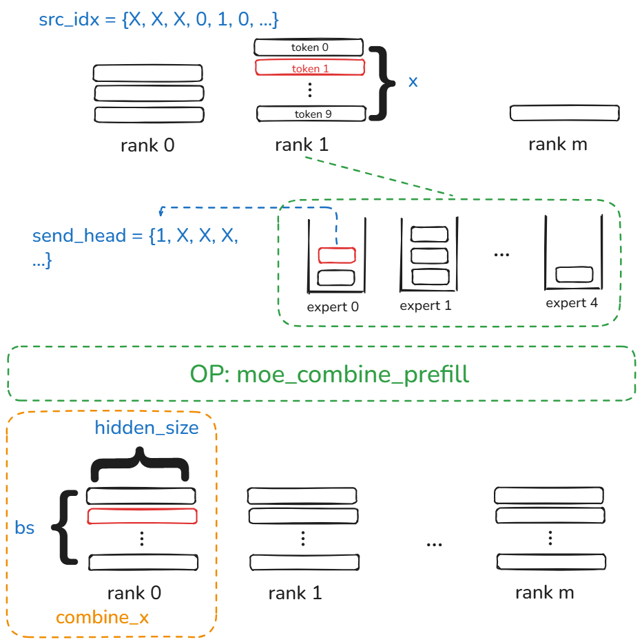

# CAM API Guide
## Introduction
 **CAM**  is short for  **C**ommunication  **A**cceleration for  **M**atrix on Ascend NPU. CAM provides EP (Expert Parallelism) communication kernels, high performance KVCache transfer for PD disaggregation and KVC pooling, AFD communication kernels, RL weights transfer and so on. CAM is easily to be run in single kernel mode or integrated into vllm or SGLang framework. 

## CAM Structure
（To be done）

## CAM API
### 1. EP Communication Kernels
UMDK provides high-performance Python interfaces for communication and fused computation-communication via "umdk_cam_op_lib". Users can use this lib in popular Ascend inference framework, such as vllm-ascend, sglang-kernel-npu, etc.
#### 1.1 Interfaces of Dispatch & Combine
 #### 1.1.1 get_dispatch_layout ▶
##### 1.1.1.1 Prototype 
```python
get_dispatch_layout(
    Tensor topk_idx, 
    int num_experts, 
    int num_ranks)
-> output: tuple(Tensor, Tensor)
```
##### 1.1.1.2 Interface Description 

Interface used before dispatch in prefill phase for A3, which copies the current tokens in this rank TopK times and rearranges these tokens in experts' granularity. This interface should used with moe_dispatch_prefill and moe_combine_prefill.
##### 1.1.1.3 Input Parameters 
| **📌Parameter** | **🔧Type** | **✅Required/Optional** | **📋Value Range** | **📝Details** |
|----------|----------|--------------|--------------|----------|
|topk_idx|Tensor|Required|Shape:(batch_size, topk)， int64 type，Range：[0, num_experts)|ID info for target experts|
|num_experts|int|Required|Range：(0, 512]|MOE experts number|
|num_ranks|int|Required|Range：[1, 384]|rank number in EP communication group|
##### 1.1.1.4 Return Value
Return value of this interface is a tuple made of 2 tensor, which stores num_tokens_per_expert and send_token_idx respectively.
| **📌Parameter** | **🔧Type** | **📋Value Range** | **📝Details** |
|----------|----------|--------------|----------|
|num_tokens_per_expert|Tensor|Shape：（num_experts）|token value sent to each expert in this rank|
|send_token_idx|Tensor|Shape：(batch_size, top_k)|The position offset of each token after re-arrangement in experts' perspective|
##### 1.1.1.5 Constraints and Precautions ⚠️
1. Input Shape should satisfy the shape definition above.
2. Current interface supports A3 only.
3. Current interface does not support concurrent usage.
4. Do not support dynamic graph when in GE mode; Do not support fullgraph=true.
5. Other Constraints need to be satisfied:
 - top_k value range: (0, 16].
 - batch_size value range: (0, 8000]
 - Required: num_experts % num_ranks == 0
 - Required: num_experts >= num_ranks

 #### 1.1.2 moe_dispatch_prefill ▶
##### 1.1.2.1 Prototype
```python
moe_dispatch_prefill(
    Tensor x, 
    Tensor topk_idx, 
    Tensor topk_weights, 
    Tensor num_tokens_per_expert, 
    Tensor send_token_idx_small, 
    str group_ep, 
    int rank, 
    int num_ranks, 
    bool use_quant) 
-> output: tuple(Tensor, Tensor, Tensor, Tensor, Tensor)
```
##### 1.1.2.2 Interface Description 

Dispatch interface in prefill phase for A3, which sends the tokens to the target experts in the rules of topk_idx.
##### 1.1.2.3 Input Parameters 
| **📌Parameter** | **🔧Type** | **✅Required/Optional** | **📋Value Range** | **📝Details** |
|----------|----------|--------------|--------------|----------|
|x|Tensor|Required|Shape:(batch_size, hidden_size), support bf16 and float16|token sent from current rank|
|topk_idx|Tensor|Required|Shape:(batch_size, topk)， int64 type，Range：[0, num_experts)|target ID of each token|
|topk_weights|Tensor|Required|Shape:(batch_size, topk)， float32 type|weights of target experts for each token|
|num_tokens_per_expert|Tensor|Required|Shape：（num_experts），int type|token number sent to each expert in current rank, must be output num_tokens_per_expert from get_dispatch_layout, cannot be modified|
|send_token_idx_small|Tensor|Required|Shape：(batch_size, top_k), int type|The position offset of each token after re-arrangement in experts' perspective, must be output send_token_idx from get_dispatch_layout, cannot be modified|
|group_ep|str|Required|--|name of HCCL communication group|
|rank|int|Required|[0, num_ranks)|rank ID in communication group|
|num_ranks|int|Required|[2, 384]|rank number of EP group|
|use_quant|bool|Required|True: use quant； False: do not use quant|Dispatch quant indicator|
##### 1.1.2.4 Return Value 
Return value is a tuple made of 5 tensors，which stores：recv_x, dynamic_scales_out, expand_idx_out, recv_count, recv_tokens_per_expert.
| **📌Parameter** | **🔧Type** | **📋Value Range** | **📝Details** |
|----------|----------|--------------|----------|
|recv_x|Tensor|Shape：(recv_token_num, hidden_size), recv_token_num is the token number received by this rank. When use_quant is true, data type is int8, and data type is the same as input x when use_quant is false.|token received in current rank|
|dynamic_scales_out|Tensor|Shape：(recv_token_num), float type. This value has no meanings when use_quant is false.|dynamic quant scale infos for received tokens in current rank|
|expand_idx_out|Tensor|Shape：(recv_token_num * 3), int type|info triplet of token received by this rank, the three numbers of each triplet is: source rank, index of token in source rank(from BS's perspective), token offset after the re-arrangement in source rank in experts' perspective|
|recv_count|Tensor|Shape：(num_experts), int type|prefix-sum number of token received in this rank from each other ranks|
|recv_tokens_per_expert|Tensor|Shape：(local_expert_num), int64 type|token received by each expert in this rank|
##### 1.1.2.5 Constraints and Precautions ⚠️
1. Input Shape should satisfy the shape definition above.
2. Current interface supports A3 only.
3. Current interface does not support concurrent usage.
4. Do not support dynamic graph when in GE mode; Do not support fullgraph=true.
5. Other Constraints need to be satisfied:
 - top_k value range: (0, 16].
 - BS value range: [1, 8K]
 - num_ranks range: [2, 384]
 - num_experts range: (0, 512]
 - required: (num_experts % num_ranks) == 0
 - required: set HCCL_BUFFSIZE = 4096
 - Required: num_experts >= num_ranks

 #### 1.1.3 moe_combine_prefill ▶
##### 1.1.3.1 Prototype
```python
moe_combine_prefill(
    Tensor x, 
    Tensor topk_idx, 
    Tensor topk_weights, 
    Tensor src_idx, 
    Tensor send_head,
    str group_ep, 
    int rank, 
    int num_ranks) 
-> output: Tensor
```
##### 1.1.3.2 Interface Description

combine interface in prefill phase for A3, which combines the token sent to each expert in topk_idx rules with weights given by topk_weights.
##### 1.1.3.3 Input Parameters
| **📌Parameter** | **🔧Type** | **✅Required/Optional** | **📋Value Range** | **📝Details** |
|----------|----------|--------------|--------------|----------|
|x|Tensor|Required|Shape:(recv_token_num, hidden_size), support bf16 and float16 types|token received of this rank in dispatch phase|
|topk_idx|Tensor|Required|Shape:(batch_size, topk)， int64 type，Range：[0, num_experts)|target experts info for each token|
|topk_weights|Tensor|Required|Shape:(batch_size, topk)， float32 type|weights of topk experts for each token|
|src_idx|Tensor|Required|Shape：(recv_token_num * 3), int type|info triplet of token received by this rank, the three numbers of each triplet is: source rank, index of token in source rank(from BS's perspective), token offset after the re-arrangement in source rank in experts' perspective. Must be output expand_idx_out from moe_dispatch_prefill, cannot be modified|
|send_head|Tensor|Required|Shape：(num_experts), int type|prefix-sum number of token received in this rank from each other ranks. Must be output recv_count from moe_dispatch_prefill, cannot be modified|
|group_ep|str|Required|--|name of HCCL communication group|
|rank|int|Required|[0, num_ranks)|rank ID of current rank in EP group|
|num_ranks|int|Required|[2, 384]|rank number of EP group|
##### 1.1.3.4 Return Value 
Return value is a tensor，which stores combine_x。
| **📌Parameter** | **🔧Type** | **📋Value Range** | **📝Details** |
|----------|----------|--------------|----------|
|combine_x|Tensor|Shape：(batch_size, hidden_size), data type is the same as x|token received in current rank|
##### 1.1.3.5 Constraints and Precautions ⚠️
1. Input Shape should satisfy the shape definition above.
2. Current interface supports A3 only.
3. Current interface does not support concurrent usage.
4. Do not support dynamic graph when in GE mode; Do not support fullgraph=true.
5. Other Constraints need to be satisfied:
 - top_k value range: (0, 16].
 - BS value range: [1, 8K]
 - num_ranks range: [2, 384]
 - num_experts range: (0, 512]
 - required: (num_experts % num_ranks) == 0
 - required: set HCCL_BUFFSIZE = 4096
 - Required: num_experts >= num_ranks
6. combine_x accuracy verification standards
 - Non-quantized scenarios: The average relative error shall be within 0.5%
 - Quantized scenarios: The average relative error shall be within 1%

 #### 1.1.4 fused_deep_moe ▶
##### 1.1.4.1 Prototype
```python
fused_deep_moe(
    Tensor x, 
    Tensor expert_ids, 
    Tensor[] gmm1_weight, 
    Tensor[] gmm1_weight_scale, 
    Tensor[] gmm2_weight, 
    Tensor[] gmm2_weight_scale, 
    Tensor expert_scales, 
    Tensor? share_gmm1_weight, 
    Tensor? share_gmm1_weight_scale, 
    Tensor? share_gmm2_weight, 
    Tensor? share_gmm2_weight_scale, 
    Tensor? expert_smooth_scales,
    Tensor? share_smooth_scales,
    Tensor? x_active_mask, 
    str group_ep, 
    int ep_rank_size, 
    int ep_rank_id, 
    int moe_expert_num, 
    int quant_mode, 
    int global_bs) 
-> output: Tensor[]
```
##### 1.1.4.2 Interface Description
Fused computation-communication operator in MoE Decode phase for A3, which merges [Dispatch + FFN(GMM1 + Swiglu + GMM2) + Combine] ,(optional) and shared expert computation in the current card, into an operator for better inference performance.
##### 1.1.4.3 Input Parameters 
| **📌Parameter** | **🔧Type** | **✅Required/Optional** | **📋Value Range** | **📝Details** |
|----------|----------|--------------|--------------|----------|
|x|Tensor|Required|Shape:(batch_size, token_length), support bf16 and float16 type|token to be sent of this rank in dispatch phase |
|expert_ids|Tensor|Required|Shape:(batch_size, topk)，int32 type, range: [-1, num_experts)，where -1 is used as a placeholder. A token cannot sent to an expert beyond one time.|target expert IDs of each token|
|gmm1_weight|Tensor[]|Required|In coupling mode，there is one tensor, Shape:(localExpertNum, token_length, gmm1_hidden_size); In separated mode，there are localExpertNum tensors, TensorShape：（token_length, gmm1_hidden_size; int8 type|GMM1 weight matrix，supports coupling mode and separated mode|
|gmm1_weight_scale|Tensor[]|Required|In coupling mode，there is one tensor, Shape:(localExpertNum, gmm1_hidden_size); In separated mode，there are localExpertNum tensors, each tensor Shape：（gmm1_hidden_size）; float32 type or the same type with x|GMM1 weight scale matrix，supports coupling mode and separated mode|
|gmm2_weight|Tensor[]|Required|In coupling mode，there is one tensor, Shape:(localExpertNum, gmm1_hidden_size/2, token_length); In separated mode，there are the localExpertNum tensors, each tensor Shape：（gmm1_hidden_size/2, token_length）; int8 type|GMM2 weight matrix，supports coupling mode and separated mode|
|gmm2_weight_scale|Tensor[]|Required|In coupling mode，there is one tensor, Shape:(localExpertNum, token_length); In separated mode，there are localExpertNum tensors, each tensor Shape：（token_length）; float32 type or the same type with x|GMM2 weight scale matrix，supports coupling mode and separated mode|
|expert_scales|Tensor|Required|Shape：(batch_size, topk), float32 type|weights of each expert，used in combine phase|
|share_gmm1_weight|Tensor|Optional|Shape：（token_length, share_gmm1_hidden_size）; int8 type|shared expert MM1 weight matrix|
|share_gmm1_weight_scale|Tensor|Optional|Shape：（share_gmm1_hidden_size）; the same type with gmm1_weight_scale|shared expert MM1 weight scale matrix|
|share_gmm2_weight|Tensor|Optional|Shape：（share_gmm1_hidden_size/2, token_length）; int8 type|shared expert MM2 weight matrix，supports coupling mode and separated mode|
|share_gmm2_weight_scale|Tensor|Optional|Shape：（token_length）; the same type with gmm2_weight_scale|shared expert MM2 weight scale|
|expert_smooth_scales|Tensor|Optional|Shape: (moe_expert_num, token_length), float32 type|smooth quant scales of routed experts|
|share_smooth_scales|Tensor|Optional|Shape: (token_length), float32 type|smooth quant scales of shared experts|
|x_active_mask|Tensor|Optional|Shape: (batch_size), bool type, value in[true, false], the true value must come before the false value|mask of input x. true means the token will be dispatched, false means the token will not be dispatched|
|group_ep|str|Required|Length of str：(0, 128), make sure it is valid|HCCL communication group name|
|ep_rank_size|int|Required|Required：(ep_rank_size * MoeExpertNumPerRank) ≤ 512, and ep_rank_size > 0|EP group size|
|ep_rank_id|int|Required|range: [0, ep_rank_size)|rank ID in EP group|
|moe_expert_num|int|Required|Required：moe_expert_num % ep_rank_size == 0|MOE expert number|
|quant_mode|int|Required|Reserved parameter, set to 0|quant mode|
|global_bs|int|Required|set to 0 or (batch_size * ep_rank_size) when token is the same in different ranks; set to (max_batch_size * ep_rank_size) otherwise.|max token number among all ranks|
##### 1.1.4.4 Return Value 
Return value is a list of tensors，which stores combine_x and expert_token_nums.
| **📌Parameter** | **🔧type** | **📋Value Range** | **📝Details** |
|----------|----------|--------------|----------|
|combine_x|Tensor|Shape：(batch_size, token_length), the same type as input x|token after combination from experts in different ranks|
|share_output|Tensor|Shape：(batch_size, token_length), the same type as input x|token result from shared expert in current card. This output will exist as placeholder even though shared expert is not enabled|
|expert_token_nums|Tensor|Shape：(local_expert_num), int64 type|token number received by each expert in current rank|
##### 1.1.4.5 Constraints and Precautions ⚠️
1. Input Shape should satisfy the shape definition above.
2. Current interface supports A3 only.
3. Current interface does not support concurrent usage.In extreme cases, repeatedly calling the same operator in a single forward pass may result in undefined behavior. To avoid potential asynchronous timing issues in such scenarios, torch.npu.synchronize() should be added between operator executions.
4. Support aclgraph only when graph in on.
5. Do not support external shared experts, that is, shared experts are deployed on dedicated cards .
6. The performance may decline when batch_size is lower than 16, as it is not the target scenario.
7. Other Constraints need to be satisfied:
 - top_k range：[0， 12] and it should be lower than expert number.
 - BS range：[0，256]
 - num_experts range：(0， 512]
 - Required: token length range: [1024, 7168] and (hidden_size % 256) == 0
 - Required: gmm1_hidden_size range: [1024, 6144] and (gmm1_hidden_size % 1024) == 0
 - Required: share_gmm1_hidden_size range: [1024, 6144] and (share_gmm1_hidden_size % 1024) == 0
 - Required：HCCL_BUFFSIZE should be greater than [(ep_rank_size * max_batch_size * moe_expert_num_per_rank * total_length * sizeof(x) * 2) / 1024 / 1024], which should be round up to the nearest integer.
 - Required：global_bs ≥ 0 and（global_bs % ep_rank_size） == 0
 - Required: gmm1_weight, gmm1_weight_scale, gmm2_weight, gmm2_weight_scale should be in the same mode
 - Required: share_gmm1_weight, share_gmm1_weight_scale, share_gmm2_weight, share_gmm2_weight_scale must exist at the same time if shared expert computation is enabled
 - Required: expert_smooth_scales must exist if routed expert smooth quantization is enabled, furthermore, share_smooth_scales must exist if shared expert computation is enabled

#### 1.2 Zero-Buffer Dispatch & Combine Interfaces
Zero-Buffer DeepEP-style Prefill interfaces based on SHMEM, callable in PyTorch eager mode. The Python entry is `umdk_cam_op_lib.ZbBuffer`. The pipeline is: create `ZbBuffer` → `buf.get_dispatch_layout` → `buf.dispatch` (internal notify + dispatch) → expert computation → `buf.combine`.

`ZbBuffer` manages SHMEM initialization, communication metadata, and communication buffers. Standalone Python functions named `umdk_cam_op_lib.get_dispatch_layout_zb`, `umdk_cam_op_lib.moe_dispatch_normal_zb`, or `umdk_cam_op_lib.moe_combine_normal_zb` are not exposed. The descriptions below follow the current Python interface.

 #### 1.2.1 ZbBuffer ▶
##### 1.2.1.1 Prototype
```python
umdk_cam_op_lib.ZbBuffer(
    int rank,
    int num_ranks,
    int local_mem_size,
    str ip_port,
    int hidden,
    int num_experts,
    bool use_quant,
    int global_bs
) -> buf: ZbBuffer
```
##### 1.2.1.2 Interface Description
Creates a Zero-Buffer communication object, initializes SHMEM on the current NPU device, and allocates communication metadata and layout / notify buffers. SHMEM buffers for dispatch / combine are allocated on the first `dispatch` and reused.

The constructor specifies the EP rank, expert count, hidden dimension, quantization flag, and global batch upper bound. Methods use these settings and the object's `comm_meta_ptr` internally. TP settings are fixed to `tp_world_size=1` and `tp_rank_id=0`; callers do not pass them to the methods.
##### 1.2.1.3 Input Parameters
| **📌Parameter** | **🔧Type** | **✅Required/Optional** | **📋Value Range** | **📝Details** |
|----------|----------|--------------|--------------|----------|
|rank|int|Required|`[0, num_ranks)`|This card's rank ID in the EP domain, distinct from its local NPU device ID|
|num_ranks|int|Required|`[2, 384]`|EP world size|
|local_mem_size|int|Required|Positive integer, in bytes|SHMEM pool size per rank; must cover communication buffers, metadata, and allocation overhead|
|ip_port|str|Required|For example, `tcp://127.0.0.1:8666`; across nodes, use an address reachable by all ranks|SHMEM initialization address; all ranks in the domain use the same address|
|hidden|int|Required|`[1024, 7168]`|Token hidden dimension; must equal `x.size(1)`|
|num_experts|int|Required|`(0, 512]`, divisible by `num_ranks`|Total routed expert count; must be at least `num_ranks`|
|use_quant|bool|Required|`False`: no quantization; `True`: dynamic quantization|Must match the `quant_mode` passed to `dispatch`|
|global_bs|int|Required|Positive integer; use `max_batch_size * num_ranks`|Global batch upper bound; `max_batch_size` must cover every rank's local token count in this and subsequent rounds using the object|
##### 1.2.1.4 Return Value
Returns a `ZbBuffer` object. `buf.is_initialized()` reports initialization status; `buf.get_comm_meta_ptr()` returns the internal communication metadata address. Normal layout / dispatch / combine calls do not need this address.
##### 1.2.1.5 Constraints and Precautions ⚠️
1. A3 only. Set `SHMEM_HOME_PATH` and enable SHMEM support when building `umdk_cam_op_lib`. Set the current device with `torch.npu.set_device` before constructing the object.
2. All ranks in the domain should use consistent `num_ranks`, `local_mem_size`, `ip_port`, `hidden`, `num_experts`, `use_quant`, and `global_bs`, and execute communication calls in the same order.
3. `local_experts = num_experts // num_ranks`. The first dispatch allocates receive/combine buffers with `capacity = global_bs * min(topk, local_experts)` rows. A token's topk expert IDs must not contain duplicates.
4. The bf16 / fp16 combine buffer requires `capacity * hidden * 2` bytes. Quantization adds `capacity * 4` bytes for scales; the int8 receive area shares the combine buffer's underlying memory. The pool must also include 2 MiB of communication metadata, layout / notify buffers, and allocation overhead. See `estimate_zb_shmem_bytes` in the sample for sizing guidance.
5. The first dispatch fixes the input dtype and buffer capacity. Subsequent dispatch calls must use the same dtype and require no more than the initially allocated capacity.
6. The object reuses internal buffers sequentially. Do not invoke it concurrently or interleave multiple layout / dispatch / combine rounds. Returned SHMEM Tensors are views of buffers owned by the object; later calls may overwrite their data. Copy data to independent Tensors when it must be retained.
7. Destroying the object frees its SHMEM buffers and ends the SHMEM session. Complete NPU operations using those buffers first, for example with `torch.npu.synchronize()`. Do not use its SHMEM Tensor views or metadata address after destruction.

 #### 1.2.2 ZbBuffer.get_dispatch_layout ▶
##### 1.2.2.1 Prototype
```python
buf.get_dispatch_layout(
    Tensor topk_idx
) -> output: Tuple[Tensor, Tensor]
```
##### 1.2.2.2 Interface Description
Counts tokens sent by the current rank to each expert from each token's topk expert indices, and computes each `(token, topk)` pair's local send index from the destination expert's view. Expert and rank counts come from the `ZbBuffer` constructor. The underlying call is `aclnnDispatchLayoutZb`.
##### 1.2.2.3 Input Parameters
| **📌Parameter** | **🔧Type** | **✅Required/Optional** | **📋Value Range** | **📝Details** |
|----------|----------|--------------|--------------|----------|
|topk_idx|Tensor|Required|Shape: `(batch_size, topk)`; `torch.int32` is recommended|Target expert IDs; layout converts non-int32 input internally without modifying the original Tensor. Subsequent dispatch / combine calls still require int32|
##### 1.2.2.4 Return Value
Returns a Tuple of 2 Tensors: `num_tokens_per_expert`, `send_token_idx`.
| **📌Parameter** | **🔧Type** | **📋Value Range** | **📝Details** |
|----------|----------|--------------|----------|
|num_tokens_per_expert|Tensor|Shape: `(num_experts,)`, dtype `torch.int32`; in SHMEM|Tokens sent by the current rank to each expert; reuses the object's internal buffer|
|send_token_idx|Tensor|Shape: `(batch_size, topk)`, dtype `torch.int32`|For each token sent to an expert, its local index among tokens that expert receives from the current rank|
##### 1.2.2.5 Constraints and Precautions ⚠️
1. `batch_size` range: `[1, 8000]`; it must not exceed the constructor's `global_bs // num_ranks`.
2. `topk` range: `(0, min(16, num_experts)]`; expert IDs must be in `[0, num_experts)`, with no duplicates for a single token.
3. Input must be on the object's NPU device. The converted int32 Tensor must be two-dimensional and contiguous.
4. Pass outputs unchanged to the same object's dispatch for this round. Do not call layout again before this round's combine completes.

 #### 1.2.3 ZbBuffer.dispatch ▶
##### 1.2.3.1 Prototype
```python
buf.dispatch(
    Tensor x,
    Tensor topk_idx,
    Tensor send_token_idx,
    Tensor num_tokens_per_expert,
    int quant_mode
) -> output: Tuple[Tensor, Tensor, Tensor]
```
##### 1.2.3.2 Interface Description
Sends `x` to target experts according to `topk_idx`. Internally calls `aclnnNotifyDispatchZb` followed by `aclnnMoeDispatchNormalZb` (the underlying `moe_dispatch_normal_zb` operator), saves send indices needed by combine, and returns received data, quantization scales, and the communication handle for this round.
##### 1.2.3.3 Input Parameters
| **📌Parameter** | **🔧Type** | **✅Required/Optional** | **📋Value Range** | **📝Details** |
|----------|----------|--------------|--------------|----------|
|x|Tensor|Required|Shape: `(batch_size, hidden)`, dtype `torch.bfloat16` or `torch.float16`|Tokens sent by this card; device and hidden dimension must match the object|
|topk_idx|Tensor|Required|Shape: `(batch_size, topk)`, dtype `torch.int32`|Expert IDs used for this round's layout|
|send_token_idx|Tensor|Required|Shape: `(batch_size, topk)`, dtype `torch.int32`|The same object's `send_token_idx` output from this round's layout|
|num_tokens_per_expert|Tensor|Required|Shape: `(num_experts,)`, dtype `torch.int32`; in SHMEM|The same object's `num_tokens_per_expert` output from this round's layout|
|quant_mode|int|Required|`0`: no quantization, requires `use_quant=False`; `2`: dynamic quantization, requires `use_quant=True`|Dispatch quantization mode|
##### 1.2.3.4 Return Value
Returns a Tuple of 3 Tensors: `recv_x`, `scales`, `handle`.

Let `total_recv_tokens` be the actual receive count computed by internal notify. The current implementation returns `recv_rows = max(total_recv_tokens, 1)` rows.
| **📌Parameter** | **🔧Type** | **📋Value Range** | **📝Details** |
|----------|----------|--------------|----------|
|recv_x|Tensor|Shape: `(recv_rows, hidden)`; `torch.int8` when quantized, otherwise the same dtype as `x`; in SHMEM|Receive-buffer view already sliced internally according to the receive count|
|scales|Tensor|Dtype `torch.float32`; when quantized, shape `(recv_rows,)`, in SHMEM; otherwise shape `(1,)`|Dynamic quantization scale per received token; without quantization, only a placeholder with no valid numerical meaning|
|handle|Tensor|Shape: `(num_experts, num_ranks)`, dtype `torch.int32`|The `put_offset` produced by internal notify; pass unchanged to this round's combine|
##### 1.2.3.5 Constraints and Precautions ⚠️
1. `batchSize` range: `[1, 8000]`.
2. `ep_world_size` range: `[2, 384]`.
3. `ep_rank_id` range: `[0, ep_world_size)`.
4. `moe_expert_num` range: `(0, 512]`.
5. `topk` range: `(0, 16]`.
6. Values in `topk_idx` must be in `[0, moe_expert_num)`.
7. `h` range: `[1024, 7168]`.
8. `moe_expert_num % ep_world_size == 0`, and `moe_expert_num >= ep_world_size`.
9. `recv_x` must match the valid receive range of `moe_dispatch_normal_zb` (expert outputs truncated by `total_recv_tokens`).
10. `ep_recv_counts` must come directly from dispatch notify `put_offset` (or equivalent EP send/recv counts).
11. If `send_token_idx` is provided, it must come directly from `get_dispatch_layout_zb`.
12. `comm_meta_ptr` must be valid and from the same communication-domain init as dispatch.
13. A2 is not supported (A3 only).

 #### 1.2.4 zb_fused_deep_moe ▶
##### 1.2.4.1 Prototype
```python
ZbBuffer.zb_fused_deep_moe(
    Tensor x,
    Tensor expert_ids,
    Tensor[] gmm1_weight,
    Tensor[] gmm1_weight_scale,
    Tensor[] gmm2_weight,
    Tensor[] gmm2_weight_scale,
    Tensor expert_scales,
    Tensor? share_gmm1_weight,
    Tensor? share_gmm1_weight_scale,
    Tensor? share_gmm2_weight,
    Tensor? share_gmm2_weight_scale,
    Tensor? expert_smooth_scales,
    Tensor? share_smooth_scales,
    Tensor? x_active_mask,
    Tensor[] gmm1_bias,
    Tensor[] gmm2_bias,
    Tensor? share_gmm1_bias,
    Tensor? share_gmm2_bias,
    str group_ep,
    int ep_rank_size,
    int ep_rank_id,
    int moe_expert_num,
    int quant_mode,
    int global_bs
) -> output: Tuple[Tensor, Tensor, Tensor]
```
##### 1.2.4.2 Interface Description
Fused computation-communication operator on the Zero-Buffer (SHMEM) path, merging [Dispatch + FFN(GMM1 + SwiGLU + GMM2) + Combine]. The HCCL data plane is replaced by SHMEM shared-memory direct writes. It supports W8A8 / W4A8 quantization modes (W4A8 is auto-detected by the presence of the `gmm1_bias` input), built-in shared experts, and multi-round round-buffer reuse. `ZbBuffer` must be initialized with a SHMEM pool (`local_mem_size`) first. The underlying call is `aclnnFusedDeepMoeZb`; the three attributes `ext_info`, `shmem_workspace`, `shmem_workspace_size` are injected internally by `ZbBuffer` and do not need to be passed by the user.
##### 1.2.4.3 Input Parameters
| **📌Parameter** | **🔧Type** | **✅Required/Optional** | **📋Value Range** | **📝Details** |
|----------|----------|--------------|--------------|----------|
|x|Tensor|Required|Shape: `(batch_size, token_length)`, supports bf16 / float16, FORMAT_ND|Token to be dispatched in this rank|
|expert_ids|Tensor|Required|Shape: `(batch_size, topk)`, dtype `torch.int32`, range `[-1, moe_expert_num)`; -1 is a placeholder, a token cannot be sent to the same expert more than once|Target expert ids of each token|
|gmm1_weight|Tensor[]|Required|Coupling mode: 1 Tensor of shape `(local_expert_num, token_length, gmm1_hidden_size)`; separated mode: `local_expert_num` Tensors each of shape `(token_length, gmm1_hidden_size)`; `torch.int8` for W8A8, `torch.int32` for W4A8 (INT4 packed, hidden dim stored as `gmm1_hidden_size/8`)|GMM1 weight matrix list, supports coupling / separated modes|
|gmm1_weight_scale|Tensor[]|Required|Coupling mode: 1 Tensor of shape `(local_expert_num, gmm1_hidden_size)`; separated mode: `local_expert_num` Tensors each of shape `(gmm1_hidden_size)`; dtype float32 / bf16 / fp16|GMM1 weight quant scale, mode must match gmm1_weight|
|gmm2_weight|Tensor[]|Required|Coupling mode: 1 Tensor of shape `(local_expert_num, gmm1_hidden_size/2, token_length)`; separated mode: `local_expert_num` Tensors each of shape `(gmm1_hidden_size/2, token_length)`; `torch.int8` for W8A8, `torch.int32` for W4A8 (INT4 packed, output dim compressed by 1/8)|GMM2 weight matrix list, supports coupling / separated modes|
|gmm2_weight_scale|Tensor[]|Required|Coupling mode: 1 Tensor of shape `(local_expert_num, token_length)`; separated mode: `local_expert_num` Tensors each of shape `(token_length)`; dtype float32 / bf16 / fp16|GMM2 weight quant scale, mode must match gmm2_weight|
|expert_scales|Tensor|Required|Shape: `(batch_size, topk)`, dtype `torch.float32`|Weights of topk experts per token, used in combine phase|
|share_gmm1_weight|Tensor?|Optional|Shape: `(token_length, share_mm1_hidden_size)`; `torch.int8` for W8A8, `torch.int32` for W4A8|Shared expert MM1 weight matrix|
|share_gmm1_weight_scale|Tensor?|Optional|Shape: `(share_mm1_hidden_size)`, dtype must match gmm1_weight_scale|Shared expert MM1 weight quant scale|
|share_gmm2_weight|Tensor?|Optional|Shape: `(share_mm1_hidden_size/2, token_length)`; `torch.int8` for W8A8, `torch.int32` for W4A8|Shared expert MM2 weight matrix|
|share_gmm2_weight_scale|Tensor?|Optional|Shape: `(token_length)`, dtype must match gmm2_weight_scale|Shared expert MM2 weight quant scale|
|expert_smooth_scales|Tensor?|Optional|Shape: `(moe_expert_num, token_length)`, dtype `torch.float32`|Smooth quant scales of routed experts|
|share_smooth_scales|Tensor?|Optional|Shape: `(token_length)`, dtype `torch.float32`|Smooth quant scales of shared experts|
|x_active_mask|Tensor?|Optional|Shape: `(batch_size)`, dtype bool, values in `[true, false]`, true values must come before false values|Mask for dispatch; true means the token is dispatched, false means not|
|gmm1_bias|Tensor[]|Required for W4A8|Coupling mode: 1 Tensor of shape `(local_expert_num, gmm1_hidden_size)`; separated mode: `local_expert_num` Tensors each of shape `(gmm1_hidden_size)`; dtype `torch.float32`|W4A8 dequant compensation matrix, `8.0 × Σ(INT4 weight) × weight_scale`; pass an empty TensorList for W8A8|
|gmm2_bias|Tensor[]|Required for W4A8|Coupling mode: 1 Tensor of shape `(local_expert_num, token_length)`; separated mode: `local_expert_num` Tensors each of shape `(token_length)`; dtype `torch.float32`|W4A8 dequant compensation matrix, `8.0 × Σ(INT4 weight) × weight_scale`; pass an empty TensorList for W8A8|
|share_gmm1_bias|Tensor?|Optional|Shape: `(share_mm1_hidden_size)`, dtype `torch.float32`|W4A8 dequant compensation matrix for shared expert MM1|
|share_gmm2_bias|Tensor?|Optional|Shape: `(token_length)`, dtype `torch.float32`|W4A8 dequant compensation matrix for shared expert MM2|
|group_ep|str|Required|Pass empty string `""` on the Zero-Buffer path|HCCL communication group name (reserved; the data plane uses SHMEM direct writes, no real communication domain needed)|
|ep_rank_size|int|Required|> 0, and `moe_expert_num_per_rank * ep_rank_size <= 512`|EP group size|
|ep_rank_id|int|Required|Range: `[0, ep_rank_size)`|Rank id in the communication group|
|moe_expert_num|int|Required|Range: `(0, 512]`, and `moe_expert_num % ep_rank_size == 0`|Number of routed MoE experts|
|quant_mode|int|Required|Reserved parameter, currently only 0 is supported|Quantization mode; W4A8 is auto-detected by the presence of the gmm1_bias input and does not rely on this parameter|
|global_bs|int|Required|Pass 0 if all ranks have the same token count (equivalent to `batch_size * ep_rank_size`); otherwise must be > 0 and `global_bs % ep_rank_size == 0`|Max token number among all ranks|
##### 1.2.4.4 Return Value
Returns a Tuple of 3 Tensors: `output`, `share_output`, `expert_token_nums`.
| **📌Parameter** | **🔧type** | **📋Value Range** | **📝Details** |
|----------|----------|--------------|----------|
|output|Tensor|Shape: `(batch_size, token_length)`, same dtype as x|Combined result of tokens processed by experts on this rank|
|share_output|Tensor|Shape: `(batch_size, token_length)`, same dtype as x|Result from the built-in shared expert; returned as a placeholder even when shared expert is disabled|
|expert_token_nums|Tensor|Shape: `(moe_expert_num / ep_rank_size)`, dtype `torch.int64`|Number of tokens received by each local expert on this rank|
##### 1.2.4.5 Constraints and Precautions ⚠️
1. Input shapes must strictly satisfy the definitions above.
2. Only the Zero-Buffer (ZERO_BUFFER) mode is supported: `shmemWorkspacePtr` must be non-zero and is injected internally by `ZbBuffer`; `ZbBuffer` must be initialized (with `local_mem_size` providing the SHMEM pool) before the call.
3. Current interface supports A3 only.
4. Current interface does not support concurrent usage. In extreme cases, repeatedly calling the same operator in a single forward pass may result in undefined behavior; add `torch.npu.synchronize()` between operator executions to avoid potential asynchronous timing issues.
5. Support AclGraph only when graph mode is on.
6. Do not support external shared experts (i.e., shared experts deployed on dedicated cards).
7. Other constraints need to be satisfied:
 - Required: batch_size range: `[0, 40960]` (Zero-Buffer upper bound)
 - Required: token_length range: `[512, 7168]`
 - Required: gmm1_hidden_size range: `[1024, 6144]`
 - Required: topk <= 12 and topk <= moe_expert_num
 - Required: moe_expert_num range: `(0, 512]`, and `moe_expert_num % ep_rank_size == 0`
 - Required: `moe_expert_num_per_rank * ep_rank_size <= 512`
 - Required: `global_bs >= 0` and `global_bs % ep_rank_size == 0` (when 0 is passed, it is computed as `batch_size * ep_rank_size`)
 - Required: gmm1_weight, gmm1_weight_scale, gmm2_weight, gmm2_weight_scale must be in the same mode (coupling or separated)
8. W4A8 mode: gmm1_bias and gmm2_bias must be provided, and W4A8 is auto-detected by their presence (`EXEC_FLAG_W4A8`); pass an empty TensorList in W8A8 mode.
9. Shared expert: if share_gmm1_weight is provided, share_gmm1_weight_scale, share_gmm2_weight, share_gmm2_weight_scale must exist at the same time; the shared scale dtypes must match the routed expert side.
10. Smooth quant: if expert_smooth_scales (shape `(moe_expert_num, token_length)`, float32) is provided, share_smooth_scales (shape `(token_length)`, float32) must also exist when the shared expert is enabled.
11. x_active_mask: if provided, shape must be `(batch_size)` and true values must come before false values.
12. SHMEM space constraints: `shmemWorkspaceSize` must be positive and no smaller than the fixed overhead (expert token-count metadata + combineSend + roundInfo + 16MB safety margin), otherwise `SHMEM workspace is too small` is reported; the per-round token count is derived from the remaining space, aligned down to 64 (GMM1_EPIM), and an error is raised if it is below 64.
13. On the Zero-Buffer path the data plane uses SHMEM direct writes, so there is no need to configure a large HCCL_BUFFSIZE according to `moe_expert_num_per_rank * global_bs * h * sizeof(x) * 2` (that check only applies to the non-Zero-Buffer path).
